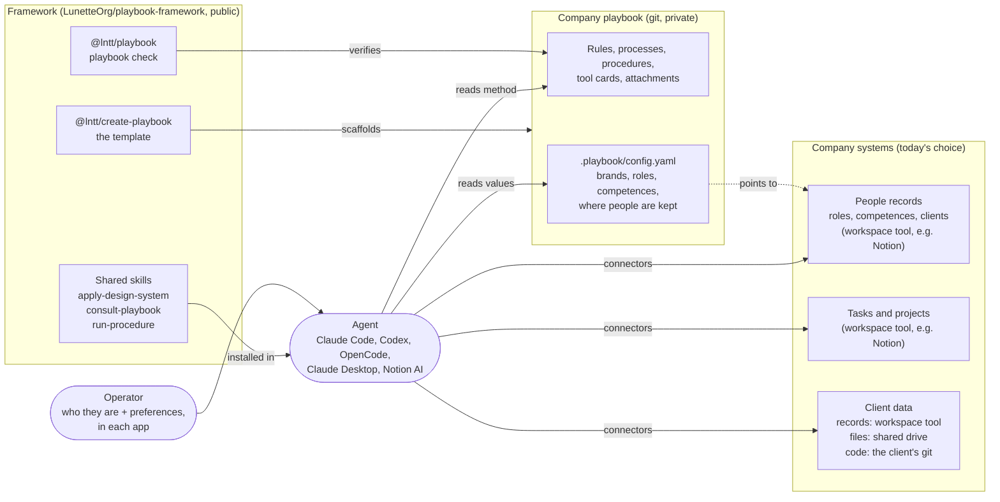
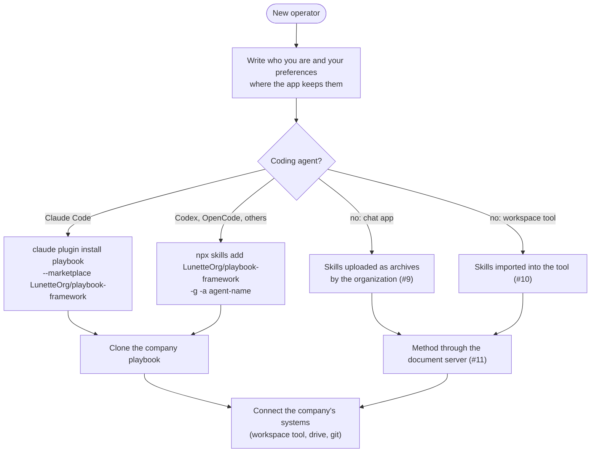

# How the framework is composed

A company runs on four kinds of content, each kept where it belongs, and on
shared skills that let any agent work with them. This page shows what lives
where, how agents reach it, and how the framework is installed in each app.

## What lives where

| Content | Where | Why there | How an agent reaches it |
|---|---|---|---|
| **Shared skills** | This repository, `plugins/playbook/`; installed once per operator in each agent ([skills-installed-per-operator](adr/skills-installed-per-operator.md)) | The same for every company; what is particular goes in the company's configuration | Loaded by the agent from its user-level skills |
| **Method**: rules, processes, procedures, tool cards, attachments | The company's playbook, a private git repository ([entries-as-files](adr/entries-as-files.md)) | One version, reviewed, with history; readable by any editor and agent; no dependency on a product | A local clone; for agents without a file system, see below |
| **Company values**: brands, roles, competences, where people are kept | The playbook's `.playbook/config.yaml` | Skills are never edited to fit a company | Read with the method |
| **People records**: roles, competences, clients a person works on | The company's workspace tool (for example Notion), where `people` points ([operator-profile](adr/operator-profile.md)) | Personal data, assigned by the company, next to its other records | The workspace tool's connector, matching the operator's identity |
| **Tasks and projects** | The company's workspace tool | Work in progress changes daily and belongs with clients and people | The workspace tool's connector |
| **Client data** | Records (CRM, contracts, meetings) in the workspace tool; files in the shared drive; code in the client's git | Each in the system made to hold it, under the company's rules on data | The connectors of those systems; git for code |

The playbook holds no data about clients or people. It says where that data
is and which rules apply to it, so an agent that is asked about a client goes
to the right system with the right limits.

### Reaching the method from apps without a file system

A chat app or a workspace tool cannot clone the playbook. The ways it can read
the method:

| Way | State | Notes |
|---|---|---|
| A remote document server (MCP) that serves entries by code, links and status | Planned, #11 | One source for every MCP client, the workspace tool's agents included; `consult-playbook` already treats it as a source |
| The workspace tool's own connector to the git host | Depends on the tool | Search over the repository; does not follow the header links |
| A read-only export of the playbook into the workspace tool | Not planned | A second copy that can drift; the playbook stays the only place it is changed |

## How it is installed in each app

| App | Skills | Who the operator is | Method | Company data | State |
|---|---|---|---|---|---|
| **Claude Code** | `claude plugin install playbook --marketplace LunetteOrg/playbook-framework`, at user level | User-level `CLAUDE.md` | A clone of the playbook | Connectors (MCP) | Works |
| **Codex, OpenCode** | `npx skills add LunetteOrg/playbook-framework -g -a <agent>` (`~/.agents/skills`) | User-level `AGENTS.md` | A clone of the playbook | Connectors (MCP) | Install verified; loading in a session not yet verified (#3) |
| **Claude Desktop, claude.ai** | Uploaded as archives through organization provisioning | Personal preferences; organization instructions generated from one source (#8) | The document server (#11) | The app's connectors | Planned (#9) |
| **Notion AI** | Imported into its skills database (name and description only) | The personal memory page | The document server (#11) | Native | Planned (#10) |
| **People who do not use git** | — | — | A synced folder or a hosted viewer | — | To compare (#12) |

A project turns a user-level skill on or off in the agent's own project
configuration ([skills-installed-per-operator](adr/skills-installed-per-operator.md)).
Generating each app's instructions and settings from the playbook is
`playbook install` (#5) and `playbook update` (#6).
